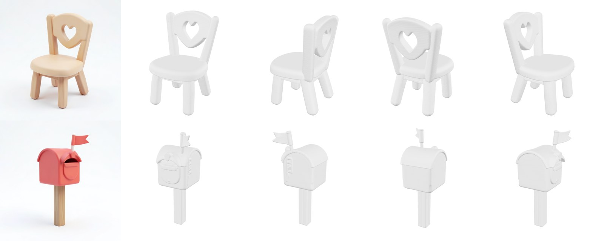

# TripoSG for AMD GPUs (ROCm)

Image-to-3D with [TripoSG](https://github.com/VAST-AI-Research/TripoSG) on AMD Radeon and Instinct GPUs, on Linux and
on Windows. Upstream needs CUDA-only packages (`diso`, `torch_cluster`); this fork replaces them with plain PyTorch
and scikit-image, so it runs on ROCm PyTorch with nothing to compile, including AMD's Windows wheels and ComfyUI's
Windows portable for AMD GPUs.



*Input image (generated with FLUX.2 [klein] on the same card) and the mesh TripoSG made from it, on a Radeon RX
7800 XT under Windows: 16-19 s per object.*

- **Same meshes as upstream.** Without `diso`, the flash decoder's unevaluated cells are filled from the coarser
  level and scikit-image runs marching cubes on the complete grid: one watertight body, same topology as upstream's
  dense path, 1.3 s at 512³.
- **Faster settings, measured.** SageAttention ([SageAttention-rocm](https://github.com/TwelveNights/SageAttention-rocm)),
  25 steps and octree depth 8 take a Radeon PRO W7900 from 37 s to 14 s per object with the same accuracy and a
  quarter of the faces, which suits game assets.
- **Works with current libraries** (diffusers, transformers) and on any PyTorch device.

## Quick start

In ComfyUI, use the [ComfyUI-3D-rocm](https://github.com/TwelveNights/ComfyUI-3D-rocm) node pack instead: TripoSG as nodes, installed from ComfyUI Manager.

Install a ROCm build of PyTorch first (Linux: `pip install torch torchvision --index-url
https://download.pytorch.org/whl/rocm7.0`; Windows: AMD's ROCm wheels), then:

```bash
git clone -b rocm https://github.com/TwelveNights/TripoSG-rocm.git && cd TripoSG-rocm
pip install diffusers transformers einops huggingface_hub opencv-python-headless trimesh omegaconf scikit-image peft jaxtyping typeguard pymeshlab
PYTHONPATH=. python scripts/inference_triposg.py --image-input assets/example_data/hjswed.png --output-path out.glb
```

For the faster settings pass `num_inference_steps=25, flash_octree_depth=8` to the pipeline, `pip install
sageattention-rocm`, and call `triposg.rocm_attention.use_sage_attention()`.

**[ROCM.md](ROCM.md)**: what changed and how it was verified, measurements, Windows notes.
Upstream's documentation: [README_upstream.md](README_upstream.md).

## Related

- [ComfyUI-3D-rocm](https://github.com/TwelveNights/ComfyUI-3D-rocm): TripoSG and Hunyuan3D-2.1 Paint as ComfyUI nodes on AMD
- [Hunyuan3D-2.1-rocm](https://github.com/TwelveNights/Hunyuan3D-2.1-rocm): Hunyuan3D-2.1 shape and PBR texturing on AMD
- [nunchaku-rocm](https://github.com/TwelveNights/nunchaku-rocm): 4-bit FLUX, Qwen-Image, Z-Image and SDXL on AMD
- [SageAttention-rocm](https://github.com/TwelveNights/SageAttention-rocm): 8-bit attention for AMD GPUs

The background remover the scripts use (BRIA RMBG-1.4) is licensed for non-commercial use only. TripoSG itself is
MIT-licensed, as is this fork.
